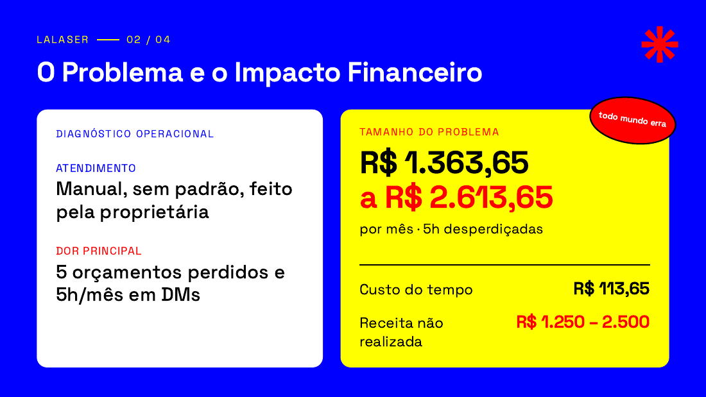
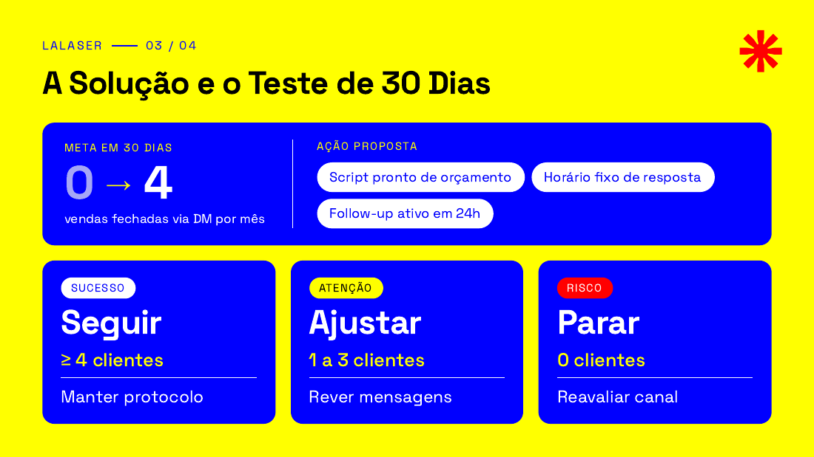

Um canvas de 9 caixas e um pitch de 90 segundos para um estúdio de remoção de tatuagem a laser que perde clientes no atendimento pelo Instagram: do problema medido em reais a um teste de 30 dias com custo zero.

```
FICHA DO PROJETO ──────────────────────

Semana ...... 10
Módulo ...... Modelagem de Negócio + Precificação
Tipo ........ Individual
Meu papel ... Problema, cálculo de impacto, precificação, hipótese, teste e pitch
Ferramentas . IA generativa (investidora cética, cálculo, crítica e pitch)
Status ...... Concluído
```

### 1. Problema
A LALAser perde pelo menos **5 potenciais clientes por mês** no atendimento inicial pelo Instagram. Os orçamentos são enviados à mão, sem padrão, e quando a conversa esfria ninguém retoma o contato. Quem sente é a proprietária, que cuida sozinha do atendimento e dos procedimentos, perde tempo com conversas picadas ao longo do dia e deixa de faturar.

**Evidência:** pelo menos 5 conversas de orçamento interrompidas por mês nas DMs, e 5 horas mensais gastas nessas conversas.

### 2. Objetivo
Provar que o problema existe, medir quanto ele custa, precificar o serviço e desenhar o menor teste possível para resolver.

> Acreditamos que mensagens prontas de orçamento, follow-up em 24h e horário fixo de resposta na DM vão aumentar as vendas. Saberemos que funcionou se os clientes fechados pela DM forem de **0** [INFORMADO] para **4** [ESTIMADO] em 30 dias.

### 3. Processo
A semana seguiu uma etapa por dia, com a IA em papéis diferentes:

1. **Segunda · O problema:** escrevi o problema sem falar de solução e passei por uma "investidora cética" de IA, que fez 5 perguntas difíceis até tirar o que estava vago.
2. **Terça · O número e o preço:** calculei o tamanho do problema e o piso de preço da sessão, com cada número marcado como INFORMADO, PESQUISADO, ESTIMADO ou CALCULADO.
3. **Quarta · A hipótese:** montei a hipótese de A para B, separei o que muda do que não muda e listei as suposições de pessoas (P), tecnologia (T) e negócio (N).
4. **Quinta · A prova:** desenhei o teste de 30 dias, passei o canvas por uma "diretora cética" de IA para achar furos e escrevi o pitch de 90 segundos.

**Tamanho do problema**

| Item | Valor | Conta | Origem |
|------|------:|-------|--------|
| Orçamentos perdidos | 5/mês | 1 por semana × 4,33 semanas | INFORMADO |
| Tempo gasto | 5 h/mês | Acumulado em atendimento no Instagram | INFORMADO |
| Valor da hora da proprietária | R$ 22,73 | R$ 5.000 ÷ 220 h | ESTIMADO |
| Custo do tempo | R$ 113,65/mês | 5 h × R$ 22,73 | CALCULADO |
| Receita não realizada | R$ 1.250 a R$ 2.500/mês | 5 vendas × R$ 250 (mínimo) ou R$ 500 (médio) | CALCULADO |
| **Tamanho do problema** | **R$ 1.363,65 a R$ 2.613,65/mês** | Custo do tempo + receita não realizada | CALCULADO |

**Preço por sessão**

| Item | Valor | Origem |
|------|------:|--------|
| Insumos (luvas, máscara, gaze, anestésico, descartáveis) | R$ 35,00 | ESTIMADO |
| Energia do laser (~0,5 kWh) | R$ 5,00 | ESTIMADO |
| Imposto rateado | R$ 15,00 | ESTIMADO |
| Desgaste do equipamento | R$ 25,00 | ESTIMADO |
| Mão de obra (1,5 h × R$ 22,73) | R$ 34,10 | CALCULADO |
| **Piso do preço** | **R$ 114,10** | CALCULADO |
| Mercado: mínima, média e alta | R$ 250 · R$ 450 · R$ 700 | PESQUISADO |
| Valor percebido | R$ 500 | INFORMADO |

### 4. Decisões
| Decisão | Por quê |
|---|---|
| **Preço de R$ 350 por sessão** | Fica bem acima do piso (R$ 114,10), deixa R$ 235,90 de margem para reinvestir e continua competitivo na faixa de mercado (R$ 250 a R$ 700) |
| Etiqueta de origem em todo número | Separa o que foi medido do que foi estimado e mostra com quem validar |
| Mudar só o atendimento na DM | Atendimento presencial, protocolo do laser e tabela de preços continuam iguais; o teste mede uma coisa só |
| Teste sem custo | Scripts, horário fixo e follow-up não exigem ferramenta nova |
| Critérios definidos antes do teste: **seguir** com 4 ou mais clientes, **ajustar** com 1 a 3, **parar** com 0 | Evita reinterpretar o resultado depois |
| Suposição mais perigosa: **a disciplina da proprietária** para manter horário e follow-up | Se a rotina não acontecer, a solução nem chega a ser testada |

| # | O que precisa ser verdade | Tipo |
|--:|---------------------------|:----:|
| 1 | A proprietária ter disciplina para responder nos horários fixos e fazer o follow-up ⚠️ | P |
| 2 | Os clientes responderem às mensagens prontas e ao follow-up | P |
| 3 | A DM do Instagram funcionar sem bloqueios ou falhas de envio | T |
| 4 | As mensagens transmitirem clareza e valor suficientes para gerar agendamento | N |
| 5 | Fechar 4 clientes por mês compensar o tempo investido no atendimento | N |

### 5. Resultado
📊 [Pitch completo (PDF)](./pitch-lalaser.pdf)





**Canvas final**

| | | |
|---|---|---|
| **1 · Problema** Perda de tempo e de vendas no Instagram por atendimento sem padrão e sem acompanhamento | **2 · Quem sofre** A proprietária, única pessoa no atendimento e nos procedimentos | **3 · Evidência** 5 orçamentos perdidos e 5 h/mês em DMs |
| **4 · Impacto e preço** R$ 1.363,65 a R$ 2.613,65/mês · R$ 350/sessão | **5 · Hipótese** Clientes fechados pela DM: de 0 para 4 em 30 dias | **6 · Solução** Mensagens padrão, horário fixo e follow-up em 24h |
| **7 · Experimento** Aplicar o protocolo a 100% dos contatos da DM por 30 dias, sem custo | **8 · Métrica** Seguir ≥ 4 · ajustar 1–3 · parar 0 | **9 · Próximo passo** Escrever e aprovar os 3 scripts em 3 dias |

**Pitch de 90 segundos (resumo):** são 5 clientes e 5 horas perdidos por mês, um prejuízo de R$ 1.300 a R$ 2.600. A proposta é testar por 30 dias, sem custo, mensagens prontas, horário fixo e follow-up em 24h. **O pedido:** a autorização da proprietária para começar na segunda-feira.

### 6. Aprendizados
- **O que funcionou:** a etiqueta de origem em cada número. Fica claro o que é fato e o que é aposta.
- **O que eu faria diferente:**
  - não somar como receita perdida 100% dos orçamentos que esfriam, porque nem todos virariam venda
  - considerar que remoção de tatuagem costuma exigir várias sessões, o que muda o valor de cada cliente
  - rever a meta: 4 fechamentos em 5 orçamentos é 80% de conversão, uma meta otimista
- **O que levo para os próximos projetos:** começar pelo problema em reais, não pela ferramenta. E definir antes do teste o que significa seguir, ajustar e parar.

### 7. Próximos passos
- [ ] Escrever e aprovar os 3 scripts de mensagem
- [ ] Rodar o teste por 30 dias e registrar orçamentos recebidos, respondidos e fechados
- [ ] Recalcular o tamanho do problema com a taxa real de conversão

---

← [Voltar para todos os projetos](../README.md) · [Portfólio](https://www.alexsandramoura.com.br) · [LinkedIn](https://www.linkedin.com/in/alexsandramoura)
