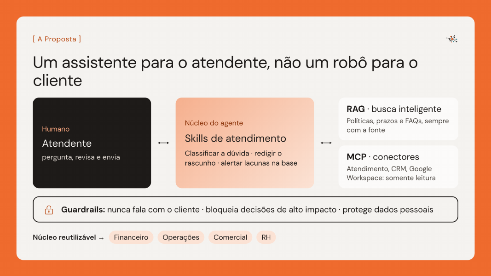
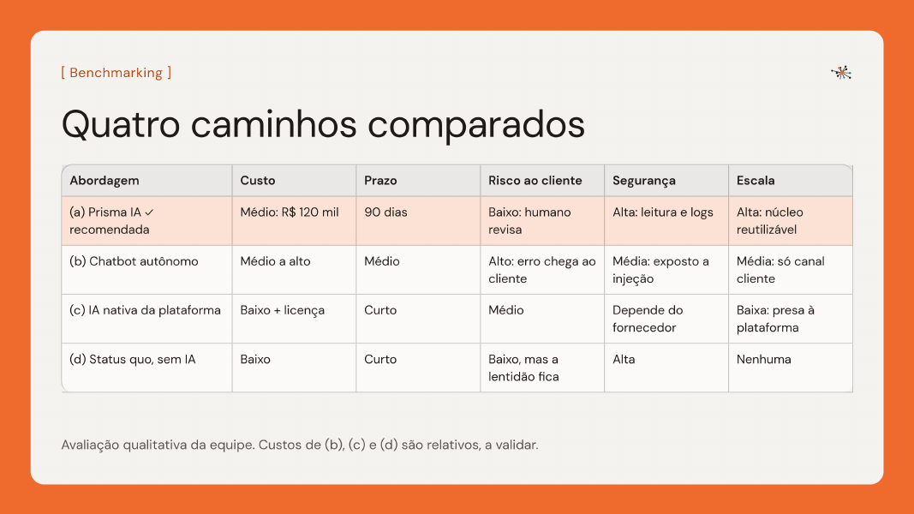

Uma proposta de consultoria, montada em 90 minutos, para uma empresa fictícia de produtos para casa e bem-estar: um assistente de IA que ajuda o atendente a encontrar respostas, em vez de um robô falando direto com o cliente.

```
FICHA DO PROJETO ──────────────────────

Semana ...... 11
Módulo ...... Consultoria de IA
Tipo ........ Em grupo (Alexsandra, Bea, Natalia, Claudia e Katherine)
Meu papel ... Integrante da equipe: diagnóstico, desenho da solução, benchmarking e pitch
Ferramentas . IA generativa · Slides · Proposta com RAG e MCP (conceitual)
Status ...... Concluído
```

### 1. Problema
A VivaBem (fictícia) tem 240 funcionários e cresceu 35% em pedidos em 18 meses, mas o quadro de pessoas cresceu só 8%. No atendimento chegam **4.000 contatos por mês**, e **35% são dúvidas repetidas** (cerca de 1.400). Cada atendente procura a resposta em vários lugares, e a coordenadora tem medo de que um robô piore a experiência do cliente.

**Causa raiz:** o conhecimento está espalhado e não há uma fonte única e confiável de respostas. O gargalo é achar a resposta, não falta de gente.

### 2. Objetivo
Escolher um caso de uso prioritário e vender à diretoria um piloto viável, seguro e mensurável: até **R$ 120 mil** e uma primeira versão utilizável em **90 dias**.

> Se o atendente tiver um assistente que encontra a resposta certa com a fonte, então o atendimento fica mais rápido sem risco para o cliente, porque nada sai sem revisão humana.

### 3. Processo
1. **Diagnóstico:** lemos os relatos das 6 áreas e separamos sintomas de causas.
2. **Priorização:** escolhemos o Atendimento pelo volume, pelo ganho rápido e pelo baixo esforço de integração para uma TI de 6 pessoas, já ocupada.
3. **Desenho da solução:** fluxo atual × futuro, com o atendente no centro e divisão do que é automático, apoiado pela IA e humano.
4. **Benchmarking:** comparamos 4 caminhos nos mesmos critérios.
5. **Business case e plano de 90 dias.**
6. **Pitch de 3 minutos** para a diretoria.

| Automatizado | Apoiado pela IA | Responsabilidade humana |
|--------------|-----------------|-------------------------|
| Busca da informação na base | Rascunho de resposta com a fonte citada | Revisar, ajustar e enviar |
| Classificação do tipo de dúvida | Sugestão de resposta para dúvidas recorrentes | Casos sensíveis, reclamações e exceções |
| Registro das sugestões usadas ou descartadas | Identificação de lacunas na base | Aprovar o conteúdo da base |

### 4. Decisões
| Decisão | Por quê |
|---|---|
| **Um assistente para o atendente, não um robô para o cliente** | Responde ao medo da coordenadora e à regra de revisão humana do briefing |
| **Busca inteligente nos documentos (RAG), sempre com a fonte** | O problema é achar a resposta certa; sem fonte, o agente diz que não sabe e escala para uma pessoa |
| **Conectores (MCP) só de leitura** com atendimento, CRM e Google Workspace | Aproveita os sistemas existentes e pede pouco da TI |
| **Núcleo reutilizável** | Financeiro, Operações, Comercial e RH entram depois como módulos, sem refazer a base. RH por último, por envolver contratação |
| **Guardrails:** nunca fala com o cliente, bloqueia decisões de alto impacto, protege dados pessoais e trata texto de cliente como dado (proteção contra injeção de instruções) | Segurança e LGPD vêm antes da escala |
| **Primeira entrega é a base organizada** | Se a base estiver desatualizada, o agente erra; é o maior risco do projeto |

| Abordagem | Custo | Prazo | Risco ao cliente | Segurança | Escala |
|-----------|-------|-------|------------------|-----------|--------|
| **(a) Prisma IA ✓** | Médio: R$ 120 mil | 90 dias | Baixo: humano revisa | Alta: leitura e logs | Alta: núcleo reutilizável |
| (b) Chatbot autônomo | Médio a alto | Médio | Alto: o erro chega ao cliente | Média: exposto a injeção | Média: só o canal do cliente |
| (c) IA nativa da plataforma | Baixo + licença | Curto | Médio | Depende do fornecedor | Baixa: presa à plataforma |
| (d) Status quo, sem IA | Baixo | Curto | Baixo, mas a lentidão fica | Alta | Nenhuma |

*Avaliação qualitativa da equipe. Os custos de (b), (c) e (d) são relativos e precisam ser validados.*

### 5. Resultado
📊 [Pitch completo (PDF)](./pitch-prisma-ia.pdf)





**Plano de 90 dias**

| Período | Entrega |
|---------|---------|
| Dias 1–30 · Base e núcleo | Levantar as dúvidas mais frequentes, organizar a base de conhecimento, medir a linha de base, definir acessos e guardrails |
| Dias 31–60 · Piloto | Ligar a busca, os conectores (só leitura) e as skills; rodar com um grupo de atendentes e treinar a equipe |
| Dias 61–90 · Medir e decidir | Continuar, corrigir ou interromper; entregar o modelo de módulo para a próxima área |

**Indicadores:** tempo médio de atendimento, tempo de primeira resposta e dúvidas resolvidas com a sugestão da IA.

**Fechamento do pitch:** recomendamos aprovar o piloto pelo ganho imediato, pela marca protegida e pela base pronta para mais 4 áreas.

### 6. Aprendizados
- **O que funcionou:** começar pelo problema e pelo medo de quem usa, não pela ferramenta. "Assistente para o atendente" resolveu a objeção principal antes de ela aparecer.
- **O que eu faria diferente:**
  - abrir os R$ 120 mil por categoria (ferramenta, implantação, treinamento, acompanhamento) em vez de usar o teto inteiro
  - dar a cada indicador uma meta numérica e uma linha de base
  - o briefing pedia justificativa econômica, e a proposta chegou sem o retorno estimado
- **O que levo para os próximos projetos:** a melhor proposta não é a que usa mais IA. É a que resolve um problema relevante de forma viável, segura e mensurável, e que diz o que ainda precisa ser validado.

### 7. Próximos passos
- [ ] Levantar as 20 dúvidas mais frequentes e medir a linha de base do atendimento
- [ ] Estimar o custo por categoria e o retorno esperado do piloto
- [ ] Montar um conjunto de perguntas de teste para avaliar o assistente antes do piloto

---

← [Voltar para todos os projetos](../README.md) · [Portfólio](https://www.alexsandramoura.com.br) · [LinkedIn](https://www.linkedin.com/in/alexsandramoura)
