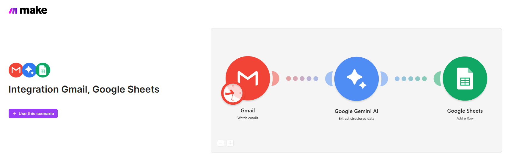

# S3 · IA na Rotina — Automação Inteligente

**Aluna:** Alexsandra Moura
**Tipo:** individual

## Links

- ⚙️ [Cenário da automação no Make (público)](https://us2.make.com/public/shared-scenario/xYeUr6R0E3J/integration-gmail-google-sheets)

## Objetivo da atividade

Criar uma automação sem código que usa IA para executar uma tarefa repetitiva da rotina.

## Entregável

Cenário no **Make** que integra Gmail, Google Gemini AI e Google Sheets:

| Etapa | Ferramenta | Módulo | O que faz |
|------:|------------|--------|-----------|
| 1 | Gmail | *Watch emails* | Monitora os e-mails com a tag **Candidatura** do Gmail (retornos de candidaturas a vagas) |
| 2 | Google Gemini AI | *Extract structured data* | Lê o texto do e-mail e extrai **empresa**, **cargo** e **data** |
| 3 | Google Sheets | *Add a row* | Grava cada candidatura como uma nova linha na planilha de acompanhamento |

## Caso de uso: controle de candidaturas

**Problema:** na busca de emprego, os e-mails de confirmação e retorno de candidaturas se misturam com o resto da caixa de entrada. Acompanhar onde me candidatei, para qual cargo e quando exigia copiar tudo à mão para uma planilha.

**Solução:** no Gmail, os e-mails de candidatura recebem a tag *Candidatura*. O Make observa essa tag e transforma cada e-mail em uma linha na planilha:

| Empresa | Cargo | Data |
|---------|-------|------|
| *extraída pelo Gemini* | *extraído pelo Gemini* | *extraída pelo Gemini* |

**Resultado:** uma planilha de candidaturas que se atualiza sozinha e serve de base para acompanhar a busca de emprego (quantas candidaturas por semana, para quais empresas, há quanto tempo sem retorno).

## Por que IA nessa automação

Cada empresa e cada plataforma de vagas manda o e-mail de candidatura num formato diferente. Uma automação tradicional (Gmail → Sheets) só copiaria campos fixos, como remetente e assunto, e o nome da empresa ou o cargo nem sempre estão ali. Com o Gemini no meio, o fluxo **lê o texto do e-mail** e encontra empresa, cargo e data em qualquer formato, sem uma regra manual para cada plataforma.

## O que aprendi

- Montar um fluxo com gatilho, processamento e saída no Make sem escrever código.
- Usar um modelo de IA como etapa de **extração de dados**, não só de geração de texto.
- Integrar ferramentas do Google Workspace em um fluxo contínuo que roda sozinho.
