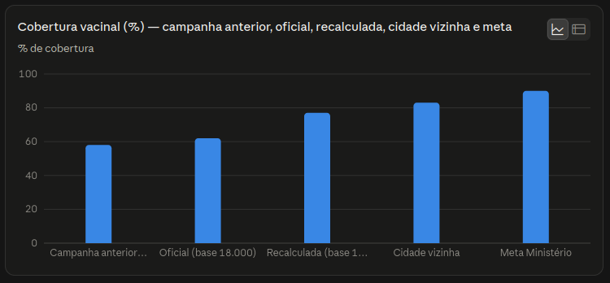
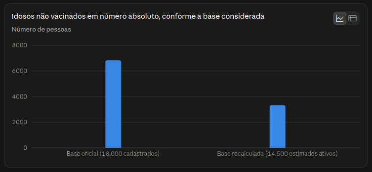
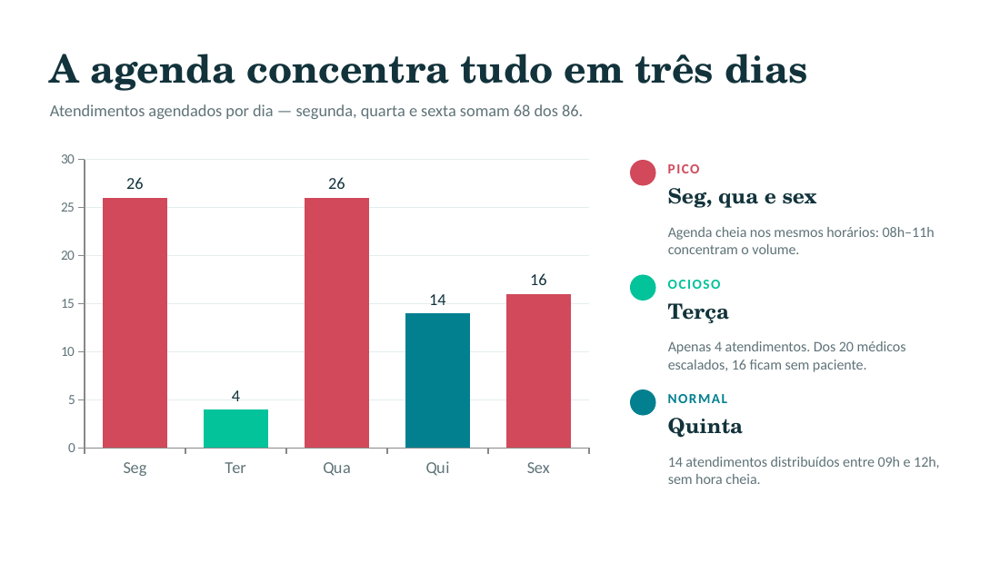
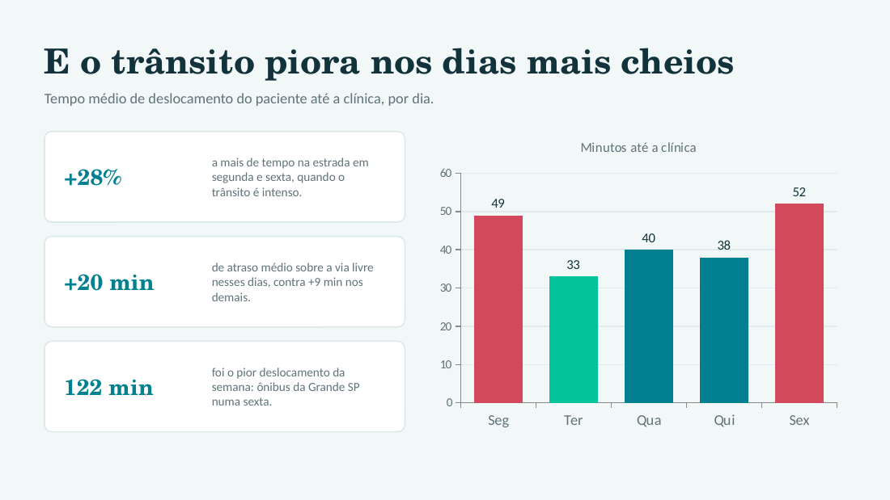

Duas análises com o mesmo princípio: separar o que o número mostra do que alguém está concluindo, e só então decidir. A primeira avalia se uma campanha de vacinação fracassou; a segunda, qual o melhor dia da semana para marcar uma consulta.

```
FICHA DO PROJETO ──────────────────────

Semana ...... 05
Módulo ...... Dados como Insumo para Decisão
Tipo ........ Individual
Meu papel ... Leitura crítica, prompt de agente, gráficos, simulação e apresentação
Ferramentas . IA generativa · planilhas · bases em Markdown
Status ...... Concluído
```

### 1. Problema
Números chegam a quem decide já acompanhados de uma narrativa. Na **Parte 1**, uma campanha de vacinação de idosos teve 62% de cobertura contra uma meta de 90%; o secretário de saúde recalculou para 77% e a oposição falou em fracasso. Na **Parte 2**, um paciente quer saber qual dia da semana dá menos fila e menos trânsito para ir a uma clínica.

### 2. Objetivo
Tomar decisões justificadas a partir de dados, sabendo dizer o que eles provam e o que não provam.

> Se eu separar fato, interpretação e lacuna antes de decidir, então a recomendação fica auditável, e não só a versão de um dos lados.

### 3. Processo
**Parte 1 · A campanha de vacinação que "fracassou"**
1. **O que os dados dizem:** organizei os números por quem os apresenta (campanha, secretário, oposição) e os dados que nenhum lado usou.
2. **O que não dizem:** de onde vem a estimativa de 14.500 idosos ativos; se a cidade vizinha é comparável; quanto a falta de vacina numa UBS pesou.
3. **Perguntas que pedem mais dados:** o método da estimativa e a comparabilidade da cidade vizinha.
4. **Prompt de agente de IA** para apoio à decisão em saúde pública.
5. **Dois gráficos**, cada um com "o que mostra" e "o que não prova".
6. **DIKW:** do dado à decisão.

**Parte 2 · Qual o melhor dia para marcar uma consulta?**
1. **Bases fictícias:** 78 pacientes, 32 profissionais, agenda de 86 atendimentos e tempo de deslocamento de cada paciente na semana de 14 a 18/09/2026.
2. **Cruzamento** da ocupação da agenda com o tempo de deslocamento.
3. **Recomendação** em ranking de dias, com ressalva por especialidade.

### 4. Decisões
| Decisão | Por quê |
|---|---|
| Mostrar a cobertura pelos dois denominadores (18.000 e 14.500) | Os 62% e os 77% vêm da mesma campanha; a escolha da base muda a história |
| Somar um gráfico em número absoluto | Mesmo na leitura favorável, **3.340 idosos** ficaram sem vacina |
| No prompt do agente, a **decisão final fica com o Conselho Municipal de Saúde** | O impacto é sobre a saúde de idosos; a IA apoia e não decide |
| Proibir o agente de inventar números ("dado não disponível") | Um agente de decisão precisa de freios explícitos |
| Revisar o corpo clínico simulado de 96 para 32 profissionais | Aplicada à base real, a regra de 1 médico para 15 pacientes pedia 32 |
| Recomendar quinta-feira para consultas com especialista | Na terça só 20 dos 32 profissionais atendem, e 12 especialidades ficam de fora |

**Prompt do agente (resumo):**
- **Análise:** fatos observáveis; lacunas, qualidade e vieses; explicações alternativas sem afirmar causa sem evidência; pelo menos duas opções de decisão
- **Esclarecimento:** antes de concluir, listar as perguntas que só um humano com os dados originais pode responder
- **Recomendação:** SIM, NÃO ou AINDA NÃO, com confiança de 0 a 100% e o que faria a recomendação mudar
- **Restrições:** não inventar números, fontes ou fatos; decisão humana final

### 5. Resultado
**Parte 1 · Gráficos**



- **O que mostra:** o denominador muda a cobertura em 15 pontos (de 62% para 77%). Mesmo assim, a campanha fica abaixo da meta (90%) e da cidade vizinha (83%).
- **O que não prova:** qual denominador é o correto, nem que a diferença para a cidade vizinha vem do modelo de campanha. O corte de agentes comunitários de saúde é outra explicação.



- **O que mostra:** mesmo na base do secretário, 3.340 idosos ficaram sem proteção.
- **O que não prova:** que todos correm o mesmo risco, nem quantos se encaixam em cada motivo da pesquisa (comunicação, distância, medo).

| Nível | Exemplo |
|-------|---------|
| **Dado** | 11.160 |
| **Informação** | 11.160 vacinados de 18.000 cadastrados |
| **Conhecimento** | Os idosos que morreram já frequentavam a UBS, mas o protocolo não previa vacinar na consulta: foi **oportunidade perdida**, não falta de acesso |
| **Sabedoria** | Em vez de discutir sucesso ou fracasso, **mudar o protocolo para vacinar em qualquer consulta de rotina** |

**Parte 2 · Recomendação**

📊 [Apresentação completa (PDF)](./apresentacao-melhor-dia-consulta.pdf)





| Dia | Atendimentos | Deslocamento médio | Trânsito | Recomendação |
|-----|-------------:|-------------------:|----------|--------------|
| **Terça** | 4 | 33 min | normal | 1º, melhor escolha |
| Quinta | 14 | 38 min | normal | 2º, boa alternativa |
| Quarta | 26 | 40 min | normal | 3º, aceitável |
| Segunda e sexta | 26 e 16 | 49 e 52 min | intenso | evitar |

Bases usadas: [pacientes](./dados/pacientes.md) · [corpo clínico](./dados/corpo-clinico.md) · [agenda semanal](./dados/agenda-semanal.md) · [tráfego e deslocamento](./dados/trafego-deslocamento.md)

**Limites da simulação:** o trânsito de cada dia foi uma premissa do modelo, e as distâncias foram sorteadas sem relação com o endereço. A média da terça vem de só 4 deslocamentos. Nenhum dia chega a lotar (ocupação de 4% a 19%). O achado mais forte da base é outro: o quadro de profissionais comporta cerca de 480 pacientes para uma base de 78.

### 6. Aprendizados
- **O que funcionou:** mostrar taxa e número absoluto juntos. Cada um conta uma parte da história.
- **O que eu faria diferente:** na Parte 2, usar distâncias reais a partir do endereço e uma amostra maior por dia antes de recomendar.
- **O que levo para os próximos projetos:** às vezes a melhor decisão não responde à pergunta original. "Sucesso ou fracasso?" vale menos do que "o que mudar no protocolo?".

### 7. Próximos passos
- [ ] Rodar o agente de decisão e comparar a análise dele com a minha
- [ ] Refazer a simulação da clínica com distâncias reais e mais semanas de agenda

---

← [Voltar para todos os projetos](../README.md) · [Portfólio](https://www.alexsandramoura.com.br) · [LinkedIn](https://www.linkedin.com/in/alexsandramoura)
