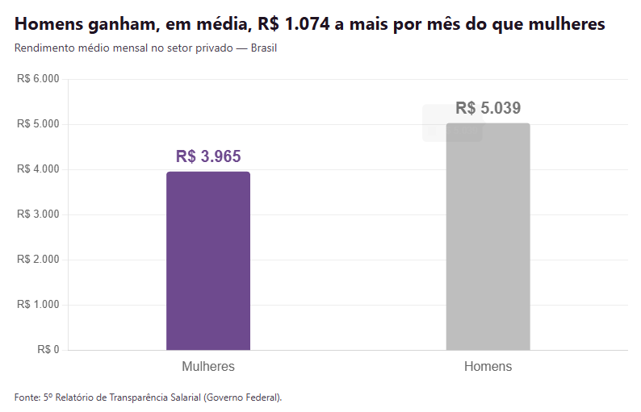
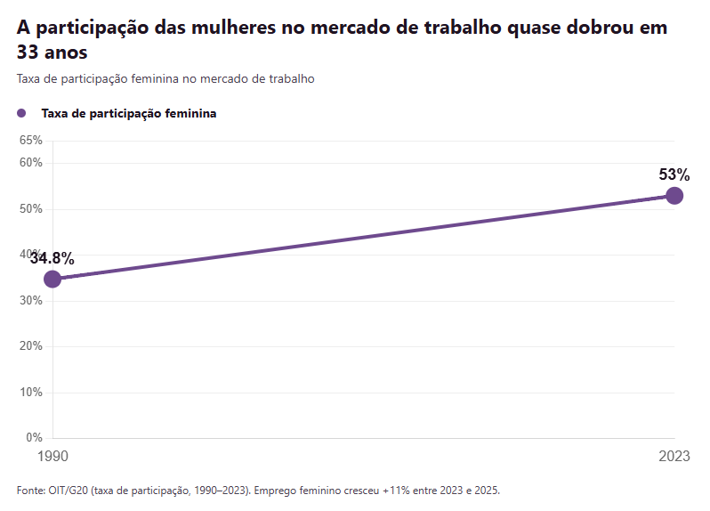

Quatro perguntas, quatro gráficos e um mini-pitch sobre desigualdade financeira de gênero no Brasil, mostrando que o problema não é falta de competência das mulheres, e sim falta de margem.

```
FICHA DO PROJETO ──────────────────────

Semana ...... 06
Módulo ...... Comunicação + Narrativa: a visualização certa
Tipo ........ Individual
Meu papel ... Perguntas, escolha dos gráficos, montagem, narrativa e pitch
Ferramentas . IA generativa · HTML + Chart.js · Google Slides
Status ...... Concluído
```

### 1. Problema
Dados sobre mulheres e dinheiro costumam virar conselho individual ("mulher precisa arriscar mais"). O gráfico errado, ou o título sem conclusão, reforça essa leitura em vez de mostrar a estrutura por trás dela.

### 2. Objetivo
Entregar de 2 a 4 gráficos, cada um com o tipo certo para a pergunta que responde, limpos e honestos, mais um mini-pitch de 60 segundos sobre o principal.

> Se cada gráfico responder uma pergunta e tiver um título com a conclusão, então quem assiste entende o argumento em segundos.

### 3. Processo
1. **Perguntas:** listei o que os dados precisavam comunicar.
2. **Tipo:** classifiquei cada pergunta (comparar, compor, tendência, distribuir, relacionar).
3. **Gráfico:** escolhi o tipo certo para cada uma.
4. **Montagem:** gerei os gráficos em HTML com Chart.js, com apoio de IA.
5. **Limpeza e pitch:** eixo no zero, sem 3D, uma cor de destaque, título com conclusão e o roteiro de 60 segundos.

| # | Pergunta | Tipo | Gráfico |
|--:|----------|------|---------|
| 1 | Homens e mulheres têm o mesmo acesso a contas, cartões e pagamentos digitais? | Comparar | Colunas agrupadas |
| 2 | Como mulheres e homens se diferenciam em comportamentos financeiros? | Comparar | Colunas agrupadas |
| 3 | Quais desigualdades financeiras mostram a maior diferença entre os grupos? | Comparar | Colunas |
| 4 | Como evoluiu a participação das mulheres no mercado de trabalho? | Tendência | Linha |

### 4. Decisões
| Decisão | Por quê |
|---|---|
| Roxo para mulheres e cinza para homens em todos os gráficos | Uma cor de destaque guia o olho; o resto fica neutro |
| Diferença salarial como gráfico principal | É a explicação material dos outros três: sem sobra de renda, não há risco possível |
| Mostrar a rentabilidade das carteiras junto com a baixa presença na Bolsa | Desmonta a leitura fácil de que "mulher tem medo de risco" |
| Dizer no pitch que é média geral, não "mesma função" | Média reflete setor, ocupação e jornada; dizer isso deixa o argumento mais forte |
| Usar só início e fim (1990 e 2023) no gráfico de tendência, e avisar | Um recorte de dois pontos não mostra a série completa |

### 5. Resultado
**1. Acesso a serviços financeiros**


A diferença aparece nas três portas de entrada e é maior no **cartão: 63% delas contra 77% deles**. O cartão dá acesso a crédito, então a desvantagem começa antes de qualquer decisão de investir.

**2. Poupança e Bolsa**


Os homens investem em ações cerca de 3 vezes mais (4,9% contra 1,5%). Mas a rentabilidade das carteiras femininas superou a dos homens em 4,6% num estudo de Terrance Odean (Berkeley), e são eles que mais investem por intuição (13,7% contra 7,5%).

**3. Diferença salarial: o gráfico principal**



**4. Participação no mercado de trabalho**



A participação feminina subiu de **34,8% para 53%** entre 1990 e 2023. Elas entraram no mercado, mas isso não virou patrimônio.

**Mini-pitch (60s)**

> Este gráfico mostra a remuneração média em empresas privadas com 100 ou mais empregados: homens recebem R$ 5.039 por mês; mulheres, R$ 3.966. São R$ 1.074 de diferença, quase R$ 13 mil por ano.
>
> É uma média geral: reflete setor, ocupação e jornada, não só a mesma função. Mas a desigualdade é real, e ela tira das mulheres justamente a sobra que permite poupar, investir e montar uma reserva.
>
> E isso acontece mesmo com elas tendo, em média, mais escolaridade. Estudar, sozinho, não corrige a diferença de renda.
>
> Minha recomendação é transparência salarial. A Lei 14.611/2023 já obriga empresas com 100 ou mais empregados a publicar relatórios semestrais. Falta transformar esse dado em correção.

**Conclusão dos 4 gráficos:** não é falta de competência; é falta de margem; e a saída não é individual (corrigir renda, dividir o cuidado e traduzir a linguagem do mercado). **Sem margem, não existe escolha.**

**Fontes:** Banco Central do Brasil, Global Findex 2021 · *Elas Pagam a Conta*, Think Olga e Think Eva, 2026 · 5º Relatório de Transparência Salarial, Ministério do Trabalho e Emprego, 2026 · OIT/G20, taxa de participação 1990–2023

### 6. Aprendizados
- **O que funcionou:** a pergunta escolher o gráfico, e não o contrário. E um título com conclusão faz o gráfico ser lido em segundos.
- **O que eu faria diferente:** conferir o texto de cada slide contra a fonte. Frases como "pelo mesmo trabalho" ou "quase dobrou" vão além do que o dado mostra.
- **O que levo para os próximos projetos:** gráfico honesto também é dizer o que ele não mostra. E os gráficos funcionam juntos: o salário (3) explica o comportamento de investimento (2).

### 7. Próximos passos
- [ ] Corrigir nos slides os rótulos dos eixos, que aparecem como 1, 2, 3
- [ ] Trocar o gráfico de tendência por uma série anual completa

---

← [Voltar para todos os projetos](../README.md) · [Portfólio](https://www.alexsandramoura.com.br) · [LinkedIn](https://www.linkedin.com/in/alexsandramoura)
