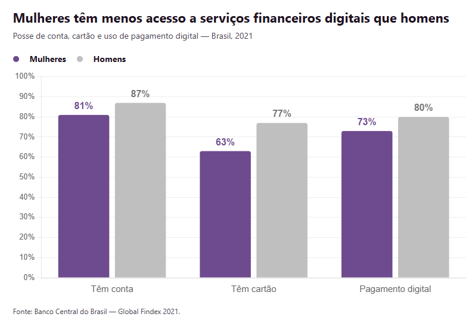
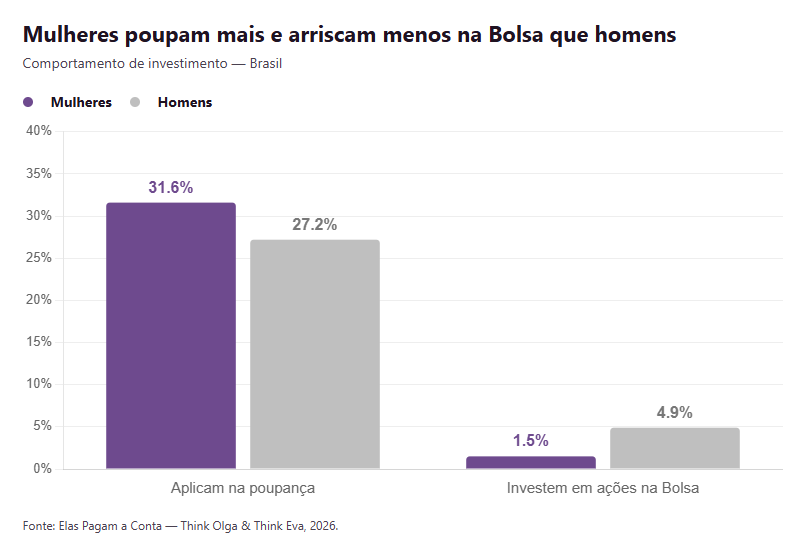

# S6 · Meus Dados no Gráfico Certo — Mulheres e dinheiro no Brasil

**Aluna:** Alexsandra Moura
**Tipo:** individual

## Objetivo da atividade

Escolher, montar e apresentar a visualização certa: de 2 a 4 gráficos, cada um com o tipo adequado à pergunta que responde, limpos e honestos, mais um mini-pitch de 60 segundos sobre o gráfico principal.

## Do problema ao gráfico

| # | Pergunta | Tipo | Gráfico escolhido |
|--:|----------|------|-------------------|
| 1 | Homens e mulheres têm o mesmo acesso a contas, cartões e pagamentos digitais? | Comparar | Colunas agrupadas |
| 2 | Como mulheres e homens se diferenciam em comportamentos financeiros? | Comparar | Colunas agrupadas |
| 3 | Quais desigualdades financeiras mostram a maior diferença entre os grupos? | Comparar | Colunas |
| 4 | Como evoluiu a participação das mulheres no mercado de trabalho? | Tendência | Linha |

Os gráficos foram montados em HTML com Chart.js e seguem o checklist de gráfico honesto: eixo começando no zero, sem 3D nem efeitos, uma cor de destaque (roxo para mulheres) com o resto em neutro, e título que já diz a conclusão.

## Os 4 gráficos

### 1. Acesso a serviços financeiros

A diferença aparece nas três portas de entrada e é maior no **cartão: 63% delas contra 77% deles**. Como o cartão é o que dá acesso a crédito, a desvantagem começa antes de qualquer decisão de investir.

### 2. Poupança e Bolsa

Os homens investem em ações cerca de **3 vezes mais** que as mulheres (4,9% contra 1,5%). A leitura fácil seria "mulher tem medo de risco", mas a fonte traz dois dados na direção contrária: a rentabilidade das carteiras femininas superou a dos homens em 4,6% num estudo de Terrance Odean (Berkeley), e são os homens que mais investem por intuição (13,7% contra 7,5%).

### 3. Diferença salarial: o gráfico principal

### 4. Participação no mercado de trabalho

A taxa de participação feminina subiu de **34,8% para 53%** entre 1990 e 2023. O gráfico usa só dois pontos, início e fim, e não a série completa. Elas entraram no mercado, mas isso não virou patrimônio: a brecha salarial e o cuidado não pago continuam.

## Mini-pitch (60s)

> Este gráfico mostra a remuneração média em empresas privadas com 100 ou mais empregados: homens recebem R$ 5.039 por mês; mulheres, R$ 3.966. São R$ 1.074 de diferença, quase R$ 13 mil por ano.
>
> É uma média geral: reflete setor, ocupação e jornada, não só a mesma função. Mas a desigualdade é real, e ela tira das mulheres justamente a sobra que permite poupar, investir e montar uma reserva.
>
> E isso acontece mesmo com elas tendo, em média, mais escolaridade. Estudar, sozinho, não corrige a diferença de renda.
>
> Minha recomendação é transparência salarial. A Lei 14.611/2023 já obriga empresas com 100 ou mais empregados a publicar relatórios semestrais. Falta transformar esse dado em correção.

## A conclusão dos 4 gráficos

1. **Não é falta de competência.** A rentabilidade das carteiras delas é maior.
2. **É falta de margem.** Risco exige dinheiro que pode ser perdido, e 21% a menos de renda tira essa sobra.
3. **A saída não é individual.** Corrigir renda, dividir o cuidado e traduzir a linguagem do mercado financeiro.

**Sem margem, não existe escolha.**

## Fontes

- Banco Central do Brasil, Global Findex 2021 (gráfico 1)
- *Elas Pagam a Conta*, Think Olga e Think Eva, 2026 (gráfico 2 e estudo de Terrance Odean)
- 5º Relatório de Transparência Salarial e de Critérios Remuneratórios, Ministério do Trabalho e Emprego, abril de 2026 (gráfico 3)
- OIT/G20, taxa de participação 1990–2023 (gráfico 4)

## O que aprendi

- **A pergunta escolhe o gráfico**, não o contrário: comparação pede colunas, tendência pede linha.
- **Título com conclusão** faz o gráfico ser lido em segundos.
- **Gráfico honesto também é dizer o que ele não mostra:** média não é "mesma função", e dois pontos não são uma série histórica.
- **Os gráficos funcionam juntos.** O salário (gráfico 3) explica o comportamento de investimento (gráfico 2).
