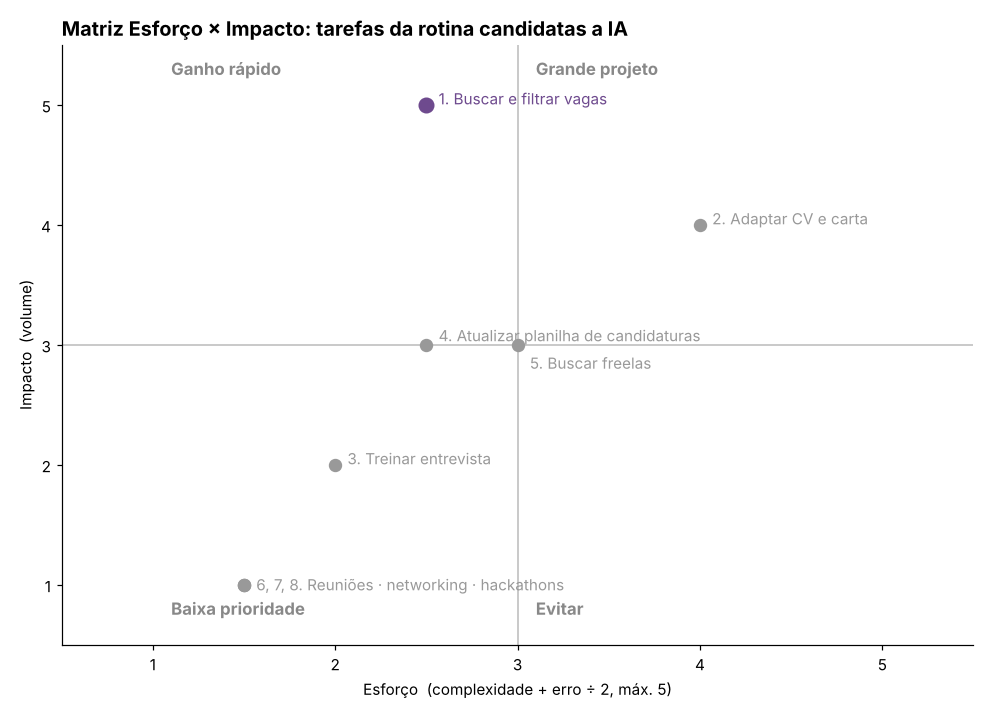

# S7 · Matriz de Esforço × Impacto — Priorizando onde usar IA

**Aluna:** Alexsandra Moura
**Tipo:** individual

## Objetivo da atividade

Mapear tarefas da rotina, priorizar quais valem uma solução com IA usando uma matriz de esforço × impacto e validar a tecnologia escolhida antes de construir.

## 1. Inventário de tarefas

Cada tarefa recebeu uma nota de 1 a 5 em volume, risco de erro e complexidade, e uma hipótese de tecnologia:

| # | Tarefa | Tipo | Volume | Erro | Complexidade | Tecnologia (hipótese) | **Impacto** | **Esforço** |
|--:|--------|------|:------:|:----:|:------------:|-----------------------|:-----------:|:-----------:|
| 1 | Buscar e filtrar vagas de Moda e UI/UX | Braçal | 5 | 1 | 2 | Agente | **5** | **2,5** |
| 2 | Adaptar CV e carta para cada vaga (ATS, escopo, título) | Mental | 4 | 4 | 2 | RAG | **4** | **4** |
| 3 | Treinar respostas para entrevista | Mental | 2 | 2 | 1 | LLM | **2** | **2** |
| 4 | Atualizar planilha de candidaturas | Braçal | 3 | 3 | 1 | LLM | **3** | **2,5** |
| 5 | Buscar freelas (Upwork, 99Freelas, Workana) | Braçal | 3 | 2 | 2 | Agente | **3** | **3** |
| 6 | Reuniões de planejamento (Discovery e Refinamento) | Mental | 1 | 1 | 1 | RAG | **1** | **1,5** |
| 7 | Buscar recrutadores e pessoas para networking | Braçal | 1 | 1 | 1 | LLM | **1** | **1,5** |
| 8 | Acompanhar inscrições de hackathons | Braçal | 1 | 1 | 1 | LLM | **1** | **1,5** |

**Fórmulas da planilha:**
- **Impacto** = volume
- **Esforço** = complexidade + (erro ÷ 2), com teto de 5

## 2. Matriz



*Gráfico refeito a partir dos valores da planilha original.*

**Prioridade: tarefa 1, buscar e filtrar vagas.** É a de maior impacto (5) com esforço baixo (2,5), no quadrante de ganho rápido.

A tarefa 4, atualizar a planilha de candidaturas, já foi automatizada na [S3](../S3-ia-na-rotina-automacao/), com Gmail + Gemini + Google Sheets.

## 3. Validação da tecnologia com IA

Antes de construir, pedi a uma IA, no papel de especialista em soluções com IA, que avaliasse a escolha:

```text
Você é um especialista em soluções com Inteligência Artificial.
Estou analisando o seguinte problema do meu dia a dia para criar uma solução com IA:
Buscar e filtrar vagas de Moda e UI/UX.
A tecnologia que estou pensando em usar inicialmente é: Agente de IA.

Com base nessas informações:
- Apresente 3 exemplos reais ou casos de uso semelhantes no mercado que resolvem
  esse mesmo tipo de problema usando IA.
- Faça 3 perguntas críticas sobre a viabilidade técnica, disponibilidade de dados ou
  esforço de implementação que eu preciso responder antes de começar a desenvolver.
- Avalie se a tecnologia escolhida por mim é a ideal para este caso de uso ou se outra
  abordagem seria mais eficiente e simples. Considere que queremos focar em soluções
  de baixo risco e alto impacto.
```

### O que voltou

**Casos de mercado:**
- **LinkedIn:** busca de vagas em linguagem natural e "Job Match", que explica por que uma vaga foi recomendada
- **Jobright Agent:** pontua vagas contra o perfil e se candidata sozinho (só vagas dos EUA)
- **Indeed Career Scout:** aprende preferências e acompanha candidaturas (só no app)

O ponto em comum: os três têm acesso próprio e legal a uma base enorme de vagas, e a IA é só a camada de cima. Esse é justamente o ponto fraco de um projeto individual.

**Perguntas críticas:**
1. De onde vêm as vagas, e há acesso legal e estável a elas? Fazer scraping viola termos de uso, e sites com login quebram agentes.
2. O critério de filtro está escrito de forma explícita? Sem uma rubrica, a IA filtra por achismo.
3. Quanto tempo a solução custa para ser feita, contra quanto tempo economiza?

**Veredito: um agente autônomo não é a melhor escolha para começar.**

| Critério | Agente autônomo | Automação + 1 chamada de LLM |
|----------|-----------------|------------------------------|
| Fonte de dados | Navega em sites; quebra com login, captcha ou mudança de layout | Alertas de vaga que os sites já mandam por e-mail |
| Risco legal | Scraping pode violar termos de uso | Nenhum: só lê o próprio e-mail |
| Previsibilidade | Baixa | Alta: o fluxo é fixo e só a classificação usa IA |
| Custo | Muitas chamadas por execução | 1 chamada por vaga |
| Tempo para funcionar | Semanas | Um fim de semana |

## 4. Decisão: trocar a tecnologia

Troquei a hipótese de **Agente** pela arquitetura de **automação + LLM**:

1. **Entrada:** alertas de vaga (LinkedIn, Gupy, Indeed, Vagas.com, Catho) chegando no Gmail
2. **Automação:** Google Apps Script lê os alertas uma vez por dia
3. **IA, uma única tarefa:** o LLM recebe a vaga e uma rubrica escrita e devolve um JSON com trilha, se a senioridade serve, nota e motivo
4. **Saída:** planilha com todas as vagas e filtro para as de nota ≥ 7

**Decisões de projeto:**
- **Gravar todas as vagas, não só as aprovadas**, para enxergar os falsos negativos
- **Coluna "Sua avaliação"** para validar a IA nas 2 primeiras semanas. Se ela errar mais de 20%, o ajuste é na rubrica, não na tecnologia
- **Sem candidatura automática:** cada candidatura precisa de contexto próprio
- **Agente só depois**, para tarefas de vários passos sobre vagas já filtradas (ex.: pesquisar a empresa e sugerir qual case do portfólio destacar)

## O que aprendi

- **A matriz evita começar pela tarefa mais divertida** em vez da que mais rende.
- **Questionar a própria hipótese mudou a solução:** o "agente" virou uma automação simples com IA numa única etapa, com menos risco e mais previsibilidade.
- **A tecnologia não é o gargalo, o critério é.** Antes de construir, a rubrica de filtro precisa estar escrita e testada com vagas reais.
