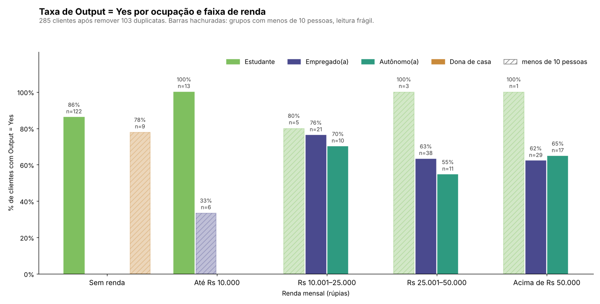

# S8 · Nossa Análise Avançada — Ocupação × Renda

**Equipe:** Alexsandra Moura, Karol de Castro e Rilza Boaventura
**Tipo:** em grupo
**Tema do grupo (1):** o efeito da ocupação sobre o comportamento de pedido muda conforme a faixa de renda? É o direcionamento mais avançado da turma, porque cruza duas variáveis.

## Objetivo da atividade

Partir de um dataset compartilhado pela turma (pedidos de delivery online) e entregar uma análise completa: dado preparado, padrão encontrado, visualização e recomendação estratégica para duas personas, apresentada em 5 minutos.

## A base

Dataset de pedidos de delivery online com 388 linhas e 13 colunas: idade, gênero, estado civil, ocupação, renda mensal, escolaridade, tamanho da família, tipo de cliente, latitude, longitude, CEP, `Output` (Yes/No) e feedback. A renda está em rúpias (Rs), e os CEPs são de Bangalore, na Índia.

## 1. Diagnóstico e limpeza

| Problema | O que encontramos | Como resolvemos |
|----------|-------------------|-----------------|
| **Duplicatas** | 103 linhas duplicadas exatas (388 → 285) | Remoção com prompt, pedindo à IA que informasse o total removido |
| **Coluna fantasma** | Uma coluna idêntica a `Output`, criada por uma vírgula sobrando no fim do cabeçalho | Coluna removida |
| **Formato inconsistente** | `Monthly Income`, `Family size`, `latitude` e `Pin code`. A latitude virou data no Excel (ex.: `9766-12-01` no lugar de `12.9766`) | Padronização |
| **Erro de digitação** | `Self Employeed` | Correção |
| **Formatos misturados** | `Ph.D`; faixas de renda escritas de jeitos diferentes (`Below Rs.10000` com moeda, `10001 to 25000` sem moeda) | Padronização |
| **Tipo errado** | CEP salvo como número inteiro | Conversão para texto |

## 2. Padrões encontrados

Taxa de clientes com `Output = Yes` em cada combinação de ocupação e renda:

*Gráfico refeito a partir do dataset sem duplicatas, com o tamanho de cada grupo (n) indicado.*

| Ocupação | Padrão | Solidez |
|----------|--------|---------|
| **Estudantes** | Taxa alta em qualquer faixa: 86% sem renda (105 de 122) e 80% a 100% nas faixas com renda | ✅ Sólido para "sem renda" (n=122). As faixas com renda têm de 1 a 13 pessoas |
| **Empregados** | A taxa sobe de 33% (abaixo de Rs 10.000) para 76% (Rs 10.001–25.000) e se estabiliza entre 62% e 63% nas faixas mais altas | ⚠️ As faixas com n de 21 a 38 sustentam o patamar de 62% a 76%. O "salto" a partir de 33% vem de **só 6 pessoas** (2 de 6) |
| **Autônomos** | Estável entre 55% e 70% acima de Rs 10.000, sem variações extremas | ✅ Moderado (n de 10 a 17) |
| **Donas de casa** | 78% (7 de 9), todas sem renda própria | ⚠️ Grupo pequeno |

**Leitura:** a ocupação pesa mais que a renda. Estudantes pedem muito mesmo sem renda própria. Para empregados, a renda baixa aparece associada a menos pedidos, mas a amostra dessa faixa é pequena demais para afirmar um limiar.

## 3. Recomendação estratégica

**Regra de negócio para campanhas:**
- **Estudantes:** apostar em frequência, não em poder de compra. Combos de baixo custo, entrega rápida, indicação (member-get-member) e programa de pontos.
- **Empregados com renda de Rs 10.001–25.000:** a faixa de maior resposta. Ofertas de conveniência para a rotina.
- **Empregados abaixo de Rs 10.000:** cupom de primeira compra e isenção de taxa de entrega, **como teste**, para confirmar se a baixa adesão se repete numa amostra maior.

| Persona | O que o achado significa |
|---------|--------------------------|
| **A · Operação e logística** | Estudantes geram volume constante, independentemente da renda declarada. Vale cruzar ocupação com região para dimensionar a frota onde eles se concentram |
| **B · Mercado e produto** | Segmentar por ocupação antes de segmentar por renda: combos e fidelidade para estudantes, ofertas de entrada para empregados de renda baixa |

## Limitações

- **Grupos pequenos:** várias combinações têm menos de 10 pessoas (hachuradas no gráfico) e não sustentam conclusão sozinhas.
- **O que `Output` mede:** o grupo leu `Output = Yes` como "faz pedido online". O dataset não documenta a coluna com precisão.
- **Correlação, não causa:** o dataset não tem dados de mesada, rotina ou motivação. Explicações como "suporte familiar" são hipóteses para testar.
- **Sem horário nem volume de pedidos:** recomendações sobre horários de pico pedem dados que esta base não tem.

## O que aprendi

- **80% do trabalho é limpar:** 103 duplicatas, ou 27% da base, distorceriam todas as taxas.
- **Um gráfico precisa mostrar o n.** Uma taxa de 100% com 1 pessoa não vale o mesmo que 86% com 122.
- **Cruzar duas variáveis multiplica os grupos e encolhe cada um.** É aí que a amostra pequena aparece.
